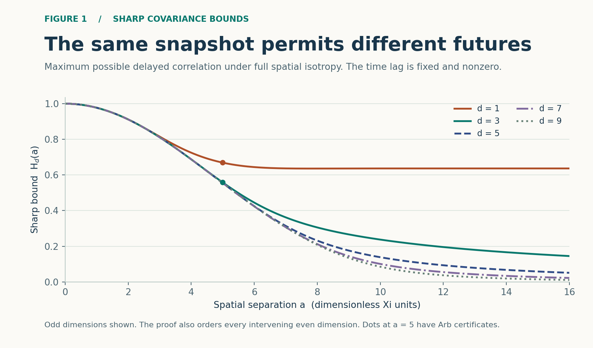
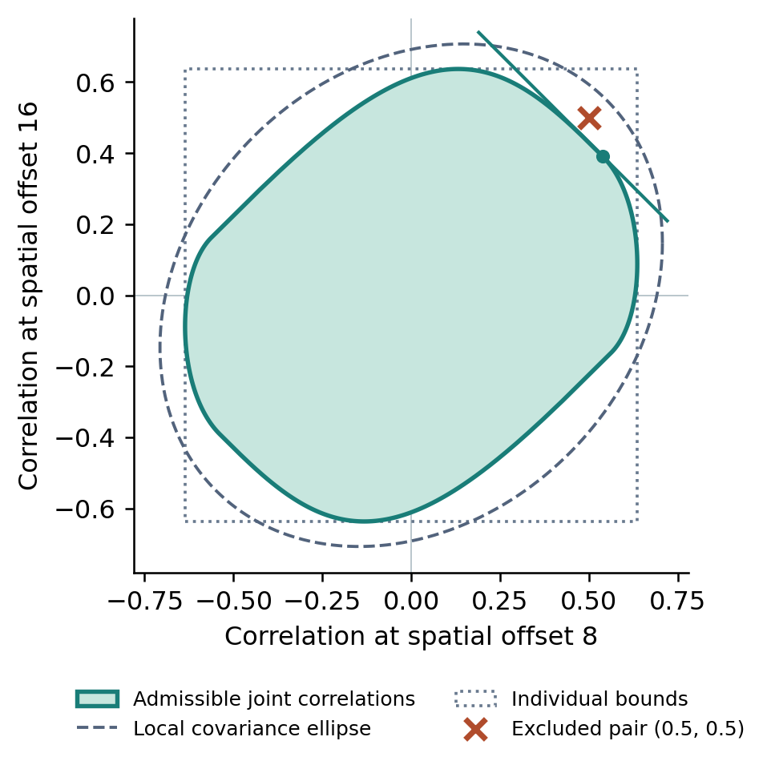
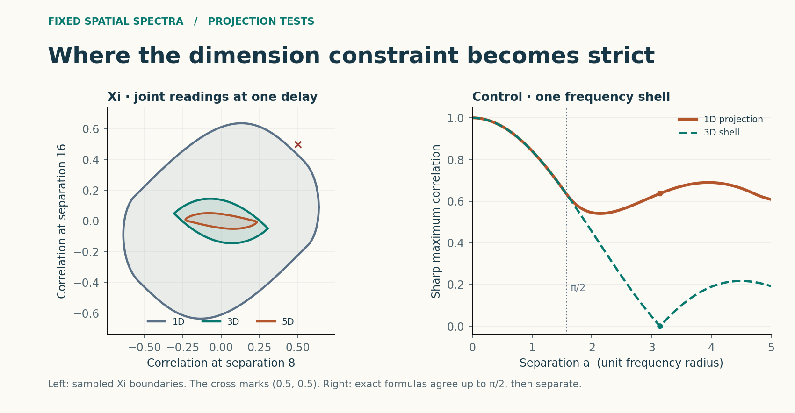
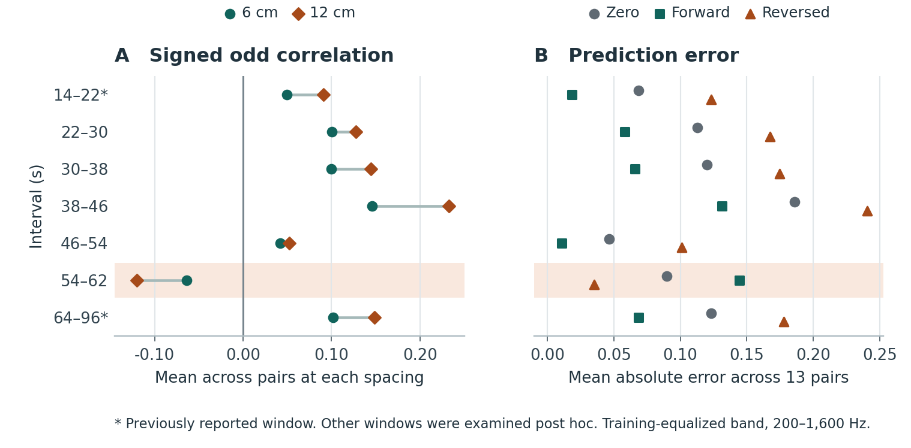

# Sharp space–time covariance bounds for the Riemann Xi profile

Why two correlations of 0.50 can be impossible together

GENESIS research program · Revision 4 · Prepared for Ian Walker · 27 November 2026

## Abstract

Two delayed correlations of **0.50** at separations 8 and 16 pass a ten-observation covariance test. Each value is individually attainable. Yet when the entire equal-time line covariance is the normalized Riemann Xi profile, their greatest possible sum is **0.9294554312** (rounded). The proposed sum is 1.00. Thus no field in the stated class can realize the pair. A Gaussian with the same curvature at zero allows a larger sum and a smaller difference. Each attainable region therefore contains pairs outside the other.

We consider a real stationary scalar field with continuous covariance, spatial isotropy at every time lag and an unrestricted temporal spectrum. At one nonzero lag, we characterize the joint region at finitely many separations. Keeping the same spatial covariance function in adjacent dimensions projects the higher-dimensional radius law onto the lower-dimensional one. We give an exact criterion for strict contraction of each single-separation bound and prove strict interior inclusion for the joint regions under an unbounded-support assumption. For Xi, the conclusions apply in the nine dimensions admitted by the companion theorem. In one microphone recording, the estimated odd correlation reverses sign in a post hoc window.

## What one snapshot fixes

Imagine sensors on a line. Their simultaneous correlations at every separation fix the spatial frequency distribution. A later reading may correlate strongly with a sensor eight units away, or with one sixteen units away. At each spatial frequency, both readings must use the same distribution of temporal frequencies. That distribution can vary with spatial frequency. This shared choice produces the sum constraint.

<b>Contribution and scope.</b> Classical spectral representations and dimension walks supply the machinery. The results here identify strict contraction under projection and quantify it for the Xi spectrum, including explicit finite examples and a Gaussian comparison. The Xi separations are dimensionless. The recording illustrates symmetry in physical units. Publication priority remains open.

<!--page-->
# The sharp limit at one separation

Let $C(h,t)$ be a continuous, real covariance on $\mathbb R^d\times\mathbb R$ of a centered, jointly stationary scalar field with variance one. Require $C(Uh,t)=C(h,t)$ for every orthogonal matrix $U$ and every $t$. At $d=1$ this requires reflection symmetry. The entire equal-time slice is prescribed:

$$ C(h,0)=F(|h|),\qquad F(s)=\frac{\xi(1/2+is)}{\xi(1/2)},\qquad
\xi(z)=\tfrac12 z(z-1)\pi^{-z/2}\Gamma(z/2)\zeta(z). $$

The function $F$ is held fixed when comparing dimensions. In dimension $d$, Fourier uniqueness fixes the spatial spectral measure, whose radius $R_d$ has law $\nu_d$. Write $\Omega_d(z)=\mathbb E[\cos(zU_1)]$, where $U$ is a uniform unit direction. In dimensions 1, 2 and 3, respectively, these functions are $\cos z$, $J_0(z)$ and $\sin(z)/z$, with value one at zero. The multiradial spectral representation is classical [1–4, 9–10]. Set the dimension of the temporal block to one to obtain a product of the radial spatial kernel and a temporal cosine. All-lag spatial isotropy justifies that substitution for the delayed observations.

**Proposition 1 (fixed-marginal corollary).** For any prescribed isotropic spatial covariance with radius law $\nu_d$, fix a spatial separation $a>0$ and a time lag $b\ne0$. The set of achievable values $C(ae_1,b)$ is precisely $[-H_d(a),H_d(a)]$, where

$$ H_d(a)=\int_0^\infty |\Omega_d(ar)|\,\nu_d(dr). $$

**Proof.** Bochner's theorem gives a positive spatial and temporal spectral measure of unit mass. Its spatial marginal is fixed by Fourier uniqueness. Average over rotations conditional on radial frequency $r$ and temporal frequency $\omega$. Reality and spatial reflection remove the sine term. Consequently,
$$ C(ae_1,b)=\int \Omega_d(ar)\,q_b(r)\,\nu_d(dr),\qquad
q_b(r)=\mathbb E[\cos(b\omega)\mid R_d=r]\in[-1,1]. $$
Conversely, every measurable $q$ in that interval is realized: at radius $r$ put temporal probability $(1+q(r))/2$ at zero and split the rest equally between $\pm\pi/|b|$. Attach a uniform spatial direction. This positive measure constructs a field covariance at every space–time lag and preserves the entire specified spatial marginal. Choosing $q=\pm\operatorname{sign}\Omega_d(ar)$ attains the endpoints. Convex mixing fills the interval. ∎

The maximizing process may depend on $a$ and $b$. At zero time lag the correlation is fixed to $F(a)$. A prescribed wave speed, time spectrum, or mixing condition is an additional restriction. For example, in one dimension advection gives $C(h,t)=F(h-at/b)$ and $C(a,b)=1$ if reflection symmetry at nonzero lags is dropped.
<!--page-->
# Why more spatial directions tighten the bound

**Theorem 2.** For the Xi profile and every $a>0$, the sharp delayed-correlation bounds satisfy
$$ |F(a)|<H_9(a)<H_8(a)<\cdots<H_2(a)<H_1(a)<
T(a),\qquad T(a)=\sqrt{(1+F(2a))/2}. $$

The companion theorem supplies existence of the Euclidean Xi covariance through dimension nine and its failure in dimension ten [7]. The strict ordering within the admissible dimensions follows from projection and the support of the Xi spectrum.

**Proof.** Project a uniform unit direction in $d+1$ dimensions onto its first $d$ coordinates. Its projected direction is uniform in $d$ dimensions and its projected length $B$ is independent of that direction, with $B^2\sim\mathrm{Beta}(d/2,1/2)$. Fourier uniqueness identifies $R_d$ in law with $BR_{d+1}$, with $B$ independent of $R_{d+1}$. Therefore
$$ \Omega_{d+1}(z)=\mathbb E\,\Omega_d(zB),\qquad
 |\Omega_{d+1}(z)|\leq \mathbb E\,|\Omega_d(zB)|. $$
Let $z_d$ be the first positive zero of $\Omega_d$ ($z_1=\pi/2$). The beta law charges every open subinterval of $(0,1)$. For $z\le z_d$, the angular average has no sign cancellation. For $z>z_d$, the continuous kernel has opposite signs on two such subintervals [6]. This proves the exact criterion for any common radial spatial profile:
$$ H_{d+1}(a)<H_d(a)\quad\Longleftrightarrow\quad \nu_{d+1}((z_d/a,\infty))>0. $$
The averaging law is the classical dimension projection [11,12,16]. For Xi, the exponential bound in the numerical section makes the inverse Fourier transform of $h\mapsto F(|h|)$ real analytic in every admissible dimension. Indeed $e^{\gamma|h|}F(|h|)$ is integrable for $0<\gamma<3/8$. Positive definiteness gives a nonnegative spectral density of total mass one. Such an analytic density cannot vanish on an open annulus. Every radial interval away from zero therefore has positive mass. This proves strictness for all adjacent dimensions and gives $|F(a)|<H_9(a)$ by sign cancellation in dimension nine.

For three observations at $(-ae_1,0),(ae_1,0),(0,b)$, the two delayed correlations agree by symmetry. Cauchy–Schwarz with the mean of the two endpoint observations gives the bound $T(a)$. In one dimension $T^2=\mathbb E\cos^2(aR_1)$. The positive line density makes $|\cos(aR_1)|$ nonconstant. Its mean $H_1$ is strictly below its root mean square. ∎

**Large separations.** The Fourier series of $|\cos|$ and the decay of $F$ give $H_1(a)\to 2/\pi$. For $d\ge2$, $\Omega_d(z)\to0$ and $\nu_d$ has no atom at zero, so $H_d(a)\to0$. In three dimensions, if $p$ is the density of $|K_1|$, the projection of a uniform sphere gives $p(s)=\int_s^\infty r^{-1}\nu_3(dr)$. Hence $aH_3(a)=\int|\sin(ar)|\,\nu_3(dr)/r\to 2p(0+)/\pi\approx2.288185$. The last averaging step uses the integrable density $\nu_3(dr)/(r\,dr)$.
<!--page-->
# One matrix accepts what the full spectrum excludes

{.wide}

| Separation $a$ | Three-event ceiling $T$ | Sharp 1D ceiling $H_1$ | Sharp 3D ceiling $H_3$ |
|---:|---:|---:|---:|
| 2 | 0.918567455 | 0.911454728 | 0.911448240 |
| 4 | 0.777110701 | 0.724945124 | 0.687627509 |
| **5** | **0.733612808** | **0.669040801** | **0.557929001** |
| 8 | 0.706559871 | 0.635963502 | 0.305470198 |
| 10 | 0.707080711 | 0.636588478 | 0.237329209 |

*Table 1. Rounded from outward interval evaluations at 192 and 256 bits. Lines in Figure 1 use numerical quadrature. Additional floating-point checks for all nine dimensions are supplied with the code.*

At $a=5$, take both delayed correlations to be $c=0.70$. The normalized three-observation matrix has determinant $(1-F(10))(1+F(10)-2c^2)\approx 0.08901478$, with positive lower-order principal minors. It passes the local test. Its correlations exceed the sharp one-dimensional ceiling by **0.03095919894**. No admissible space–time covariance with the prescribed full Xi marginal can extend this matrix.
<!--page-->
# Two separately possible readings can be impossible together

At the same time lag, let $v_j=C(a_je_1,b)$. Proposition 1 assigns one common function $q_b$ to all separations. Thus the attainable vectors form the set of integrals of $q_b(r)(\Omega_d(a_jr))_j$ with $|q_b|\le1$. Its greatest projection in any direction $u$ is
$$ h(u)=\int\left|\sum_j u_j\Omega_d(a_jr)\right|\nu_d(dr). $$
This is the support-function identity for a centered zonoid [5]. The attaining temporal spectrum uses the sign of the sum. Bounds at different time lags cannot generally be combined this way.

{.joint}

**Certified example.** In one dimension with $(a_1,a_2)=(8,16)$, the individual ceilings are 0.6359635020 and 0.6366197767. Each admits $1/2$. Their greatest possible sum is **0.9294554312**. The green region shows the feasible pairs. The proposed pair lies outside it.

Observe $0,8,16,24,32$ at two times. Let $K_{ij}=F(8|i-j|)$, and let the symmetric Toeplitz cross-time block $J$ have first row $(-3/50,1/2,1/2,0,-9/25)$. The resulting block matrix has $K$ on the diagonal and $J$ off the diagonal. Its minimum eigenvalue lies in **[0.02466248633138, 0.02466248633209]** by a verified Gershgorin enclosure. Positive principal minors establish the lower bound $1/50$. A second calculation using a theta integral and shifted determinants gives **0.024662486331735438** (rounded).

The qualitative conflict also occurs for other spectra. For any absolutely continuous line frequency law, phase averaging as $a\to\infty$ gives individual ceilings $2/\pi$ at $a,2a$ and a sum ceiling $\frac{1}{2\pi}\int_0^{2\pi}|\cos z+\cos 2z|\,dz=3\sqrt3/(2\pi)<1$. The Xi calculation establishes a finite, reproducible instance and its margin.
<!--page-->
# The entire joint region contracts

**Corollary (joint contraction).** Fix distinct positive separations $a_1,\ldots,a_m$, a single nonzero temporal lag, and the same equal-time function $F(|h|)$ in dimensions $d$ and $d+1$. Let $Z_d$ be the compact convex set of attainable vectors under the assumptions of Proposition 1. The radius laws in the two dimensions are related by projection. If the higher-dimensional radius law has unbounded support, $Z_{d+1}$ lies strictly inside $Z_d$. For Xi this holds throughout dimensions 1–9.

**Proof.** For each unit vector $u$ put $g(r)=\sum_j u_j\Omega_d(a_jr)$. The function $g(|x|)$ is the Fourier transform of a signed combination of distinct uniform frequency-shell measures. Uniqueness makes it nonzero. It must take both signs. Indeed, for $t>0$,
$$\int_{\mathbb R^d} e^{-t|x|^2}g(|x|)\,dx
  =(\pi/t)^{d/2}\sum_j u_j e^{-a_j^2/(4t)}\longrightarrow0\quad(t\downarrow0).$$
A continuous function of one sign that is nonzero on a ball could not have this limit. For sufficiently large upper radius $r$, the beta projection samples open intervals of both signs of $g(rB)$. The triangle inequality for the angular integral is strict there. Integrating over the upper tail yields a strictly smaller support function in every unit direction. Support functions are continuous on the compact unit sphere, so their difference has a positive minimum $\epsilon$. Consequently $Z_{d+1}+\epsilon\,\mathbb B_2^m\subseteq Z_d$. The support-function description gives compactness, equivalently by the weak-star compactness of the unit ball of multipliers $q$ in Proposition 1. ∎

{.wide}

*Left: floating-point illustrations at two separations with the same Xi spatial covariance function in each dimension. Right: a uniform 3D unit-frequency shell has $F(a)=\sin(a)/a$. Its 3D bound and its 1D projection agree through $\pi/2$ and at $a=\pi$ equal 0 and $2/\pi$, respectively. Repeated separations or an offset of zero can preclude strict interior inclusion in the stated ambient space.*
<!--page-->
# What changes if the Xi spectrum is replaced?

In one dimension compare the Xi spectrum with a centered Gaussian frequency law of variance $m_2=-F''(0)\approx0.04620998623084$. The Gaussian spatial profile is $\exp(-m_2a^2/2)$. Their Taylor expansions agree through quadratic order. Their fourth derivatives at zero are approximately 0.0059600173 for Xi and 0.0064060885 for the Gaussian. The comparison fixes the full profile in each model and optimizes over its allowed temporal spectra.

| Greatest attainable contrast at separations 8 and 16 | Xi | Matched Gaussian |
|:--|--:|--:|
| Sum $v_1+v_2$ | 0.9294554312 | **0.9397302702** |
| Difference $v_1-v_2$ | **0.7242833455** | 0.7146891359 |

Arb encloses all four supports. The ordering reverses between the two contrasts, so neither admissible region contains the other. For example, the Gaussian extremizer of the sum gives $(0.5396727229,0.4000575473)$, which lies outside the Xi region. The pair $(0.50,0.50)$ exceeds both sum ceilings. To distinguish these two models, the measurement uncertainty region must miss one attainable region and intersect the other, allowing for uncertainty in the spatial marginals. Other marginals may also fit.

## The dimension effect at a fixed separation

| Dimension | $H_d(8)$ | Dimension | $H_d(8)$ | Dimension | $H_d(8)$ |
|---:|---:|---:|---:|---:|---:|
| 1 | 0.635964 | 4 | 0.257025 | 7 | 0.212123 |
| 2 | 0.403034 | 5 | 0.231661 | 8 | 0.209304 |
| 3 | 0.305470 | 6 | 0.218530 | 9 | 0.208234 |

*Numerical estimates from projecting the common nine-dimensional spectral density. The analytic proof orders all nine values; dimensions 1 and 3 also have independent Arb enclosures. The estimates use two quadrature orders and check mass and the signed transform against the prescribed $F$.*

At separation **5**, Arb encloses the gap between the last two dimensions as $3.38500\times10^{-12}<H_8(5)-H_9(5)<3.42424\times10^{-12}$, about $3.4\times10^{-12}$. The calculation integrates the angular cancellation directly and bounds the discarded radial tail. The interval quantifies the ordering proved in Theorem 2. See `audit-numeric/README.md`.
<!--page-->
# An acoustic recording exposes a symmetry assumption

A snapshot cannot distinguish a recording from its exact time reversal using equal-time correlations alone. In one dimension our bound applies to the average of the two directions even if a directed measurement violates reflection symmetry. The diagnostic
$$ O_{ij}(\tau)=\tfrac12[C_{ij}(+\tau)-C_{ij}(-\tau)] $$
isolates what this averaging removes. The spectral model predicts zero for this quantity under spatial reflection and homogeneity. The sign depends on the stated channel orientation.

**Recorded test.** We reanalyzed a 48 kHz, eight-microphone lobby fan recording in the public ACE corpus [8]. Orient the pairs by increasing channel number: seven pairs at 6 cm and six at 12 cm. Use frequency bins from 200 to 1,600 Hz and $\tau=\sqrt3\,r/(2\cdot343\ \mathrm{m/s})$. The training window from 2–10 seconds sets the spectral equalizer and one mean odd correlation per spacing. Freeze those two coefficients. Compare zero, the frozen forward prediction, and its sign reversal by mean absolute error across the same 13 pairs. Lower error is better.

| Weighting / held-out interval | Symmetric zero | Frozen forward | Sign reversal |
|:--|--:|--:|--:|
| Equalized · 14–22 s | 0.06859 | **0.01824** | 0.12320 |
| Equalized · 64–96 s | 0.12329 | **0.06869** | 0.17789 |
| Native · 14–22 s | 0.05051 | **0.01634** | 0.08659 |
| Native · 64–96 s | 0.08684 | **0.05076** | 0.12292 |

*Table 2. Mean absolute errors in dimensionless normalized correlation. Both weightings use 200–1,600 Hz. “Equalized” uses the training spectrum; “native” weights the retained bins uniformly. The archived late protocol specifies the 64–96 s interval. Both holdouts come from one recording.*

The equalized means at 6 and 12 cm were 0.04946 and 0.09092 in the short holdout and 0.10147 and 0.14875 in the later holdout. The frozen forward prediction underestimated the magnitude in the later interval. These measurements do not estimate the full Xi spatial spectrum or test population reflection symmetry against a calibrated null distribution.

A second implementation synthesized band-limited, fractionally shifted waveforms from the original PCM and took time-domain inner products. It reproduced all 52 pair readings across the two weightings and two holdouts to within $1.7\times10^{-15}$. Both implementations used the same recording.
<!--page-->
# The acoustic sign reverses in an intervening window

We applied the frozen predictors to all five consecutive eight-second windows beginning at 22 s. This post hoc analysis used the same 13 oriented pairs and training coefficients. It ends at 62 s, two seconds before the longer holdout.

{.acoustic}

| Interval (s) | Equalized zero | Forward | Reversed | Native zero | Forward | Reversed |
|:--|--:|--:|--:|--:|--:|--:|
| 22–30 | 0.11289 | **0.05829** | 0.16749 | 0.07430 | **0.03822** | 0.11038 |
| 30–38 | 0.12023 | **0.06563** | 0.17483 | 0.09141 | **0.05533** | 0.12749 |
| 38–46 | 0.18596 | **0.13136** | 0.24056 | 0.15141 | **0.11533** | 0.18749 |
| 46–54 | 0.04658 | **0.01084** | 0.10118 | 0.03513 | **0.00614** | 0.07121 |
| **54–62** | 0.08961 | 0.14421 | **0.03501** | 0.07065 | 0.10673 | **0.03457** |

*Figure 4 shows the spacing means and prediction errors. Table 3 gives mean absolute errors across 13 pairs in each post hoc interval. Bold indicates the smallest error under each weighting. The numerical archive retains unrounded values.*

All 13 pairs had negative odd correlation at 54–62 s under both weightings. The forward predictor won the other four intervening windows and both original holdouts on aggregate. Accordingly, the measured sign changes within this recording. The pairs share microphones and the windows share a room. These observations do not identify a physical cause, measure the Xi profile, or establish how often a reversal occurs in other recordings. See `acoustic/README.md`.
<!--page-->
# What the computer checked

**Numerical conventions.** For $k\ge0$ put $X_n=\pi n^2e^{2k}$ and $\Phi(k)=\sum_{n\ge1}e^{k/2-X_n}X_n(2X_n-3)$. The density of the absolute one-dimensional frequency is $p(k)=\Phi(k)/\int_0^\infty\Phi(s)\,ds$ [7]. All numerical Xi checks use this convention and angular frequency.

| Item | Executed verification | Scope |
|:--|:--|:--|
| One-dimensional bound | Arb at 192 and 256 bits, 64 Fourier harmonics, five separations. Direct theta integral at $a=5$. | A separate integral encloses the same value, about $0.66904080105507527331303914291831785$. |
| Three-dimensional bound | Separate Arb quadrature at both precisions, split at the zeros of $\sin(ak)$. | Five certified values. The all-dimension projection table and plotted curves are numerical cross-checks. |
| Two-separation example | Arb integrates sign-separated lobes and also verifies coarse Riemann enclosures and a ten-observation principal-minor certificate. | Independent 96-mode Fourier and shifted-determinant checks corroborate the sum exclusion and positive eigenvalue. See `audit-numeric/`. |
| Lean | Lean 3.51.1 compiles four algebraic and eight measure-theoretic declarations. | Single-separation contraction uses explicit angular, pushforward, support and sign hypotheses. Xi, the first-zero test, joint contraction and endpoint recurrence have written proofs. |
| Acoustic replay | Raw PCM and cached spectra reproduced the short result. The same PCM supplied the late holdout and intervening windows. | Hashes, window intervals, weighting and all three prediction errors are recorded in `acoustic/`. |

For the one-dimensional computation,
$$H_1(a)=\frac2\pi+\frac4\pi\sum_{n\ge1}\frac{(-1)^{n+1}F(2na)}{4n^2-1}.$$
For $t\ge0$, Euler summation gives $|\zeta(1/2+it)|\le2+2t$. Rotating the gamma integral through $\pi/4$ gives $|\Gamma(1/4+it/2)|\le\Gamma(1/4)2^{1/8}e^{-\pi t/8}$. With $\xi(1/2)>1/4$ and $\Gamma(1/4)<5$, this yields $|F(t)|\le40(1+t)^3e^{-3t/8}$. The code bounds the remaining Fourier series geometrically. For $d=3$, $\nu_3(dr)=-r p'(r)\,dr$. Integration by parts gives
$$H_3(a)=\int_0^\infty p(r)\operatorname{sign}(\sin ar)\cos(ar)\,dr.$$
The direct integrals bound discarded theta mass. A separate Taylor enclosure integrates the differentiated density and confirms all five 3D values. Both implementations use FLINT/Arb.
<!--page-->
# What can be tested next

**Exact recurrence.** Write $A=\Omega_d(aR_d)$. At either endpoint, equality in Proposition 1 forces $\cos(b\omega)=\pm\operatorname{sign}A$ almost surely. The Xi radius measure has a density and the angular zeros are discrete. Thus $\exp(2ib\omega)=1$ almost surely: the full covariance is periodic with period $2|b|$, in particular $C(h,2b)=F(|h|)$. Spectral atoms on angular zeros can remove this implication for other profiles.

**Near the boundary.** Let $\delta=H_d(a)-|C(ae_1,b)|$ and choose $\eta>0$. A quantitative version is
$$\sup_h|C(h,2b)-F(|h|)|=1-C(0,2b)
 \leq 4\delta/\eta+2\,\mathbb P(|A|\leq\eta).$$
For the equality, bound the angular factor by one and take $h=0$. For the inequality set $y=1-\operatorname{sign}(C(ae_1,b))\operatorname{sign}(A)\cos(b\omega)$, choosing either sign at a zero. Then $\mathbb E(|A|y)=\delta$ and $1-\cos(2b\omega)\le4y$. Split at $|A|=\eta$ and bound the small-amplitude contribution by 2. A test with an estimated spatial spectrum must also budget for uncertainty in $\delta$ and in the small-amplitude probability.

A second refinement uses the measured same-location correlation $c=C(0,b)$. Over otherwise unrestricted stationary isotropic extensions the sharp upper bound becomes $\inf_{\lambda\in\mathbb R}\{\lambda c+\mathbb E|A-\lambda|\}$. Indeed $\mathbb E[Aq]\le\lambda c+\mathbb E|A-\lambda|$ for $|q|\le1$ and $\mathbb E q=c$. The optimum assigns $+1$ to the largest $(1+c)/2$ fraction of $A$, $-1$ to the rest, and randomizes any cutoff atom as needed. Proposition 1 realizes that choice at the target lag.

**Measurement error.** For $(0.50,0.50)$, suppose each reading has absolute error at most $\epsilon$ and the line-radius law has total variation error $\tau=\sup_E|\nu'(E)-\nu(E)|$. Since $|\cos(8r)+\cos(16r)|\in[0,2]$, the support changes by at most $2\tau$. The exclusion survives if $2\epsilon+2\tau<0.07054456876$. The ACE example supplies neither budget. A prospective test would calibrate sensor phase, reverse array orientation, and freeze the lag and statistic before measuring in an independent room.

**Position relative to earlier work.** Schneider and Hartlap [13] compare finite covariance constraints with continuum bounds at two separations and illustrate dimension effects. They vary the spatial spectrum of an equal-time field. Here all its weights are prescribed and the conditional temporal law varies. Multiradial Schoenberg measures and their dimension walks are also established [16]. Earlier work identifies Xi as a one-dimensional characteristic function and as a possible stationary autocorrelation [14,15]. The numerical question here is the size of the attainable delayed region for that specified marginal and its difference from a curvature-matched Gaussian. These comparisons establish the difference in the optimization problems. Priority for the strict-interior theorem and the finite Xi examples remains open.
<!--page-->
# References and provenance

1. I. J. Schoenberg (1938). *Metric spaces and completely monotone functions.* [Annals of Mathematics](https://doi.org/10.2307/1968466). Radial spectral context.
2. H. Cramér (1940). *On the theory of stationary random processes.* [Annals of Mathematics](https://doi.org/10.2307/1968827). Stationary spectral representation.
3. N. Cressie and H.-C. Huang (1999). *Classes of nonseparable, spatio-temporal stationary covariance functions.* [JASA](https://doi.org/10.1080/01621459.1999.10473885).
4. M. Horrell and M. Stein (2017). *Half-spectral space–time covariance models.* [Spatial Statistics](https://doi.org/10.1016/j.spasta.2016.12.002).
5. G. Koshevoy and K. Mosler (1998). *Lift zonoids, random convex hulls and the variability of random vectors.* [Bernoulli, 4, 377–399](https://wisotypo3.uni-koeln.de/sites/statistik/pdf_publikationen/1998_KoshevoyM98.pdf).
6. NIST. [Digital Library of Mathematical Functions, §10.17](https://dlmf.nist.gov/10.17) and [§10.21](https://dlmf.nist.gov/10.21). Bessel asymptotics and zeros used in the angular comparison.
7. I. Walker. *The exact positive-definiteness dimension of the Riemann Xi function.* [Paper I and verification at revision caacbddf](https://github.com/iqwalker-debug/xi-positive-definiteness-/tree/caacbddfdab836b6685a13b50d15a91e9c38d91e).
8. J. Eaton et al. (2016). *Estimation of room acoustic parameters: The ACE Challenge.* [IEEE/ACM TASLP](https://doi.org/10.1109/TASLP.2016.2577502). [ACE corpus, Zenodo](https://doi.org/10.5281/zenodo.6257551).
9. R. Fernández-Casal, W. González-Manteiga, M. Febrero-Bande (2003). *Space-time dependency modeling using general classes of flexible stationary variogram models*, §2, Eq. (1). [Journal of Geophysical Research](https://doi.org/10.1029/2002JD002909).
10. E. Porcu, S. F. Feng, X. Emery, A. P. Peron (2023). *Rudin extension theorems on product spaces, turning bands, and random fields on balls cross time*, §2.1, Eq. (4). [Bernoulli](https://doi.org/10.3150/22-BEJ1506).
11. D. J. Daley and E. Porcu (2014). *Dimension walks and Schoenberg spectral measures*. [Proceedings of the AMS](https://doi.org/10.1090/S0002-9939-2014-11894-6).
12. L. Golinskii, M. Malamud and L. Oridoroga (2018). *Radial positive definite functions and Schoenberg matrices with negative eigenvalues*, Theorem 3.1 and Eq. (3.3). [Transactions of the AMS](https://doi.org/10.1090/tran/6876).
13. P. Schneider and J. Hartlap (2009). *Constrained correlation functions*, §4.2 and Fig. 3. [Astronomy & Astrophysics](https://doi.org/10.1051/0004-6361/200912424).
14. T. Nakamura (2015). *A complete Riemann zeta distribution and the Riemann hypothesis*, Theorem 1.1. [Bernoulli](https://doi.org/10.3150/13-BEJ581).
15. H. Kobayashi (2016). *Some results on the ξ(s) and Ξ(t) functions associated with Riemann’s ζ(s) function*, §3.2, Eq. (57). [Preprint](https://arxiv.org/abs/1603.02954).
16. C. E. Alonso-Malaver, E. Porcu and R. Giraldo (2015). *Multivariate and multiradial Schoenberg measures with their dimension walks.* [Journal of Multivariate Analysis](https://doi.org/10.1016/j.jmva.2014.09.001).

Revision 4 · 27 November 2026. AI-assisted working manuscript prepared for Ian Walker. Verification scripts, precision settings, data provenance and replay instructions accompany the GitHub manuscript in the paper-iv directory. Calculational cross-checks share the FLINT/Arb backend. External specialist review and publication priority remain open.
